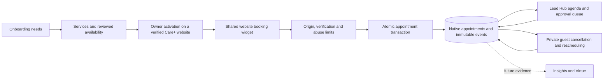

# Native booking V1 — review package

Prepared November 3, 2026. Implementation follows the accepted [booking plan](PLAN_20261103.md). The booking release is **not activated in production**. No client appointment services, public hours, emails or calendar connections have been enabled.

## Product behavior

Standard Vigil appointment management is included with Care, Growth and Priority through a new `bookings.enabled` feature row. A plan does not enable public booking: a registered live website, verified compatible component, configured active service/resource, reviewed availability and explicit owner/manager activation are required. Staff must verify the deployed component; a customer cannot assert compatibility through a crafted request. Organization overrides continue to work. Downgrade stops new bookings while retaining history, cancellation and attendance management.

Onboarding asks whether customers should contact the business, use standard Vigil bookings, use an existing scheduler, or discuss specialized scheduling. It records bookable services, confirmation preference and timezone as setup needs. Public business hours never become availability automatically. The review and creative source handoff retain these choices, and admin onboarding flags a missing booking component. Old custom-booking briefs and quoted scope retain their meaning.

Express defaults to contact inquiries. Restaurant and Salon/Spa have implemented optional native booking mounts and explicit catalogue compatibility flags. Medical and Auto Services lose implied calendar/booking wording; their forms remain inquiries. Home Services and Retail remain inquiries. New exports bind the known forms to the existing website inquiry service, including name/email and relevant inquiry details. Existing deployed customer repositories, published database snapshots and archived engine distributions are not rewritten.

A registered `contact.booking` Lab section uses the same widget as production. Both instant confirmation and approval mode can be explored without network submissions in the fictional preview. Live HTML adapters retain contact fallback when bookings are paused or unavailable and load booking assets only after an enabled configuration or a private management link is present. Existing provider links remain separate; opening an external calendar does not create a native appointment.

## One authoritative flow

Weekly hours, notice, horizon, duration, buffers, confirmed reservations and blocked dates are checked in PostgreSQL. UTC slot generation handles local daylight-saving days; nonexistent/cross-transition windows are refused, and the repeated hour has distinct instants. Each service has one single-capacity resource. Database exclusion constraints independently protect confirmed capacity, in addition to per-website transaction serialization. Pending requests do not reserve a slot; approval rechecks availability. Confirmation mode/duration/buffers/timezone are retained with the appointment. Business timezone cannot change while there are open future appointments.

Lead Hub adds Bookings within the existing workspace, with upcoming appointments, approval requests, history and setup. Initial requests and requested changes to a confirmed appointment appear in the approval workflow. Actions include confirm, decline, cancel, reschedule, approve/decline a time change, completed and no-show. Revision checks reject stale actions; a failed reschedule keeps the original slot. A native appointment links to its own inquiry and event history. Manually changing an inquiry’s status never fabricates a reservation. Source-page paths are retained for future attribution; query strings and fragments are discarded.

## Permissions, communication and limits

Tenant RLS applies to all booking records. Members can read their business records; owners/managers manage them. Direct authenticated table writes and internal definer helpers are denied. Guest management requires an appointment-specific, high-entropy credential stored only as a hash; email or an appointment ID is insufficient. Hashes and idempotency credentials are not selectable by authenticated customers. Guest credentials live in URL fragments and POST bodies, never query strings or analytics metadata. API origin registration, strict payloads, bounded bodies, distributed limits and action-specific server-verified Turnstile guard public creation. Public callers cannot choose a tenant, recipient or existing lead.

Guests receive an on-screen receipt and a private management link. **Customer/business booking emails, reminders, SMS and calendar invitations are not active in this release.** Owner setup and the guest receipt explain this boundary. Booking creation does not enqueue the existing contact notification outbox accidentally. External calendar synchronization and communication need separate reviewed setup; Search Console credentials are never reused. Availability covers appointments and blocks maintained in Vigil until a calendar connector is explicitly added.

V1 supports native appointments, approval requests and whole-date blocks. It does not provide restaurant table inventory, class/group capacity, deposits, payments, pooled resources or recurring appointments. Manual creation from an existing lead and richer partial-day blocking interfaces are follow-up work; existing records can be rescheduled by a manager. A request expires after 48 hours or its start time, whichever comes first. A bounded authenticated worker records expiry; guest/read views do not present expired requests as active.

## Cost and rollout

No model API, GPU, new scheduling subscription, email subscription or calendar provider is required for the foundation. It uses the existing application/database, one bounded expiry job every ten minutes when enabled, and public API reads/writes within operational abuse limits. Traffic, database storage and function usage remain variable operating costs; this is not a promise of unlimited free usage. Basic receives no booking entitlement and plan prices are unchanged.

`VIGIL_BOOKINGS_ENABLED=false` is the default. Review the PR and fictional preview first. For production rollout: verify a current private database backup, apply the additive migration, regenerate database types, deploy, and enable the server flag. This makes setup available without enrolling an existing website. Verify the actual deployed component, approved business services/timezone/hours and allowed test recipients before enabling any client pilot. Pause a website to stop new booking requests while retaining existing appointment management. Disabling the global flag is a maintenance stop for the entire booking API and workspace.

After pilot acceptance, prioritize explicit business notifications and customer receipts/reminders, optional external busy-time synchronization, then evidence-based booking conversion, approval delay, completion/no-show and repeat-customer insights. Virtue action permissions and communications remain a separate activation decision.

## Validation

- Full existing application suite plus booking contract, API, preview, template and attribution tests.
- Complete migration/RLS validation against a disposable local database, including wrong tenant/role/origin, Basic/downgrade, credential privacy, retries, buffers, blocked dates, failed approval/reschedule, stale revisions, expired requests and immutable evidence.
- Separate competing transactions verify a single winner for reservation, approval and rescheduling, with the losing reschedule preserving its prior slot.
- Migration supports both a fresh `extensions.btree_gist` and an existing installation in another namespace without relocating it.
- Local browser review covers both confirmation modes, no-network preview submission, contact-only Restaurant behavior, Lead Hub and setup, light/dark presentation and phone width.
- Booking database interfaces were regenerated from the isolated Supabase preview. Production legacy table definitions and unrelated production metadata are preserved.
- Final typecheck, lint, production build and CI results are recorded on the PR. Fictional UI evidence is stored alongside this release; real-client telemetry and credentials stay outside the public repository.

## November 4 calendar workspace

Lead Hub now includes day, Sunday-based week, month and daily agenda views, date navigation, resource filtering, and a selected-appointment panel using the existing approval/cancellation/rescheduling/attendance actions. The workspace uses shared dashboard surfaces with royal-blue bookings and amber requests. A single-site account avoids a redundant website chooser. Requests and History retain their separate queues.

Calendar queries read the complete selected local-date interval rather than the old 25-row agenda page, under the same organization/website scope. Rendering is capped at 500 appointments and blocks with an explicit truncation notice. Expired requests are excluded. Local midnight boundaries account for daylight-saving changes; visually colliding requests and repeated-hour appointments use separate columns. Month spillover dates and overnight appointments remain visible. Phone layouts support an agenda and horizontal calendar scrolling, with appointment details below the calendar.

The loopback review at port 4194 is fictional and performs no live booking writes. Calendar work introduces no migration, paid dependency, external calendar service or automatic communication. The subsequent account-access requirements and audit are captured in [the next phase](NEXT_ACCOUNT_ACCESS_20261104.md).

Calendar verification: six date/layout tests plus two tenant-scoped query tests passed, including 23/25-hour days, repeated-hour collisions, overnight spans and a selected appointment beyond the old 25-row page. Full application run passed 3,344 tests with four existing Design Engine timeouts under concurrent build load; rerunning all three affected files in one worker passed all 175 tests without raising timeouts. Typecheck, changed-file lint and the production build passed. [Fictional week-view screenshot](calendar-week-review.png). Final CI validates the pushed release commit.

## Production rollout — November 4

PR #45 merged as `b29c9ba9e0400689549d81bc5800fa2ca3a8dcab` after both full CI workflows and hosted preview checks passed. Production schema/data were backed up privately before migration 62; generated production types match the checked-in interfaces structurally. The production server flag now exposes booking setup and the calendar. The live Scar staff view was checked with the new route; its appointments/resources/services/settings remain empty, and public bookings are paused. No website was enrolled, availability published or customer message sent.

A follow-up adjusts small active blue labels for dark-theme contrast while retaining the royal-blue light-theme treatment.

## Standalone workspace — November 4

Bookings is separate from Lead Hub at `/dashboard/bookings`, with its own Grow sidebar entry and calendar/request/history/setup views. Saved `/dashboard/leads/bookings` links redirect with their query context intact. Linked inquiries stay accessible from appointment details.

The workspace is optional: navigation and the website selector include only explicitly requested native-booking sites or sites with existing booking settings (including paused setups and historical appointments). Contact-only sites such as Scar's do not get a booking tab or a booking setup requirement. Existing external scheduling links remain independent. This revision does not change public activation, appointment transactions or subscription rules, and requires no schema changes.
