# Website measurements — implementation review, 2 November 2026

## Scope and status

The owner approved developing the measurement foundation after prioritizing revenue and low overhead ahead of Virtue. This branch starts from freshly fetched `origin/main` `08c51a8` (PR #41), in the client application `vigilstudios/vigil-studios`. Historical worktrees and the separate lead-generation repository are preserved.

Implemented: scoped source connectors, retained evidence, scheduled collection, client reporting, Overview integration, staff connection controls and operational heartbeats. Overview is the client reporting entry point, with focused reports opened from its cards. Insights and Virtue remain in development.

**This is a reviewable implementation, not a production activation record.** Migration 60 was exercised only in disposable local PostgreSQL. No production schema, environment, project enrollment, subscription, client tracking script, service permission or customer communication was changed. The global switch defaults off and the migration enables no connections. Production rollout requires the steps in [SETUP.md](SETUP.md).

## Approved Overview integration — 3 November 2026

The owner approved consolidating the client experience around Overview after reviewing the initial reporting page. There is no separate Website analytics sidebar item. Traffic, Site quality and Vigil Security cards open focused reports through “View report”; the sidebar continues to identify these child views as Overview.

Traffic reports retain the selected website and 7/30/90-day period, and the back link restores that context. The period is reflected in Overview’s URL and is retained when changing websites. SEO/speed details contain mobile/desktop lab audits, real-user speed and Search Console; security details contain HTTPS/header checks and dependency findings. Their own measurement periods/dates remain explicit instead of being relabelled as the traffic window. The existing `/dashboard/analytics` route remains a child report destination for compatibility; it is not an additional main workspace.

The local review at `http://127.0.0.1:4193/` now starts with the production Overview components. Both that preview and the live application use the same pure measurement projection, so the cards and their detailed reports share the same normalized source data. Preview records remain fictional and isolated from customer reporting. Staff source configuration retains its complete seven-source view. No connector, entitlement, schema, credential or activation policy changed during this presentation revision.

## Measurement contract

| Source | What the client receives | Coverage and limits |
| --- | --- | --- |
| Vercel Web Analytics | Recorded visitors, page views, daily visitor trend, top paths and referrers for 7/30/90 days | Exact mapped project, production environment, UTC. Provider period totals are requested separately from daily buckets. Unreturned daily rows are omitted instead of being fabricated as zero; collection history may be shorter than the requested window. Visitor identities reset daily; these are not cross-day unique people. The project must be exclusive to that client's website. |
| PageSpeed Insights / Lighthouse | Mobile and desktop technical SEO, performance, accessibility, best-practice scores, LCP/FCP/CLS/TBT, bounded opportunities | Homepage lab audits, weekly. A final URL on another origin is rejected. SEO scores do not measure rankings or guarantee indexing; this is not a full-site crawl. |
| Chrome UX Report | Phone LCP, INP and CLS at the 75th percentile and the provider's collection period | Origin-level field data, daily refresh of a rolling historical sample. Small sites may have no eligible data; never replace it with zeros or lab numbers. |
| Public HTTPS response | Successful verified HTTPS response and observed HSTS, nosniff, referrer-policy and CSP headers | Root response only; no redirect traversal. Header presence is not a policy-effectiveness assessment, penetration test, WAF feed or continuous uptime SLA. |
| GitHub Dependabot | Open dependency alerts, severity and observation time | Explicit mapped repository, read permission required. At most five pages/500 alerts and 100 retained findings. Partial results remain partial. Missing permissions never mean clean. |
| Google Search Console | Finalized 28-day clicks, impressions, CTR, average position and top search queries | Exact URL-prefix or exact-host domain property, read-only service account, origin page filter, Pacific dates, three-day lag. Totals are independent of top-query rows; Google can withhold queries. No URL inspection or rank prediction. |
| Existing job and analytics runners | Staff-only run state, last start/completion, overdue/error indication | Instrumented execution, not an independent external uptime probe. Analytics hourly, at most two due sources per call. |

Every result records tenant, website, connection revision, target origin, observation/expiry time, coverage and a versioned normalized payload. The client DTO omits credentials, provider resource IDs and lease tokens. A failed refresh retains the last valid evidence with an attention state. Disabled/rebound connections cannot reuse an old report. Unresolved dependency alerts survive failed or overdue refreshes. Broad security categories stay unknown where no source exists.

Structured lead-stage changes now retain `from`, `to` and `recorded_stage_change` evidence in `lead_events.details`. Existing historical records remain unchanged. A manual `booked` stage is not treated as a confirmed appointment; a draft is not treated as a sent reply.

## Data flow and authorization

```mermaid
flowchart LR
  Staff[Authenticated staff] -->|Explicit per-site source opt-in| Config[Configuration RPC + audit]
  Config --> Links[Scoped provider_links]
  Cron[Authenticated hourly cron] --> Gate[Global runtime switch]
  Gate --> Claim[Service-only lease]
  Claim --> Map[Live website + organization + provider mapping]
  Map --> Providers[Fixed read-only provider endpoints]
  Providers --> Normalize[Validate and normalize bounded evidence]
  Normalize --> Commit[Recheck lease, revision and current origin]
  Commit --> Snapshots[Tenant-scoped snapshots]
  Snapshots --> RLS[RLS + session + explicit website scope]
  RLS --> Dashboard[Overview and Website analytics]
  Snapshots -. Future approved work .-> Insights[Evidence-backed Insights / Virtue]
```

Staff can configure sources or request a refresh, not call privileged collection RPCs with a browser session. Customers can read their own site's reporting; ownership or subscription eligibility does not activate sources. Source calls happen in jobs, never during dashboard rendering. No connector sends messages, buys services or changes the measured business website.

The HTTPS checker rejects IP-literal/private/local targets, validates all DNS answers, pins a public IP and uses the original hostname for TLS. Provider requests have no redirect following, bounded bodies, timeouts, sanitized error codes and a shared invocation deadline. A revision change invalidates in-flight provider binding work; the SQL commit rechecks the live origin. TLS/certificate failures produce unavailable evidence.

## Account audit and costs

A read-only account audit found an existing Vercel **Pro** team and project mappings for three live websites. The first mapped test site's traffic API returned `web_analytics_not_enabled`. The other two traffic requests returned HTTP 400; their error bodies were not independently confirmed. Speed Insights reported no field data in the audited project metadata. Project configuration identifiers alone did not establish working traffic collection. No settings were changed.

Target: **$0 in new fixed monthly subscriptions**. Existing hosting/database bills and variable usage continue. No Analytics Plus, paid security feed, queue service, dedicated server, GPU, voice service or AI inference is introduced. Dedicated read credentials are preferable to the supported existing-token fallbacks.

Vercel's published Pro collection rate is $0.03/1,000 collected events before account credits: 10,000 events ≈ $0.30; 100,000 ≈ $3; 1,000,000 ≈ $30. This is collection pricing, not a guarantee of the total hosting bill. Do not activate collection without the owner's accepted usage budget and provider spending controls. [Official pricing](https://vercel.com/docs/analytics/limits-and-pricing)

Per fully connected website: approximately 8.3 measurement runs/day (traffic four/day, two weekly lab audits, four other daily sources); about 48 Vercel read queries/day, two Search Console queries/day plus token retrieval, one CrUX query/day, one HTTPS check/day and normally one GitHub query/day. The hourly two-source cap provides 48 runs/day globally: suitable for the initial few sites, not an unlimited fleet. Review observed latency, quota, backlog and storage before expanding past roughly five fully connected sites. Derived snapshots expire from storage after 100 days; customer leads/business records are not pruned.

Google APIs and repository security access depend on authorized account configuration and quotas. Public PageSpeed access works without a key but is quota-limited; a restricted key is recommended. No paid Google tier or GitHub plan is automatically purchased. Lab audits may take up to 70 seconds per call; a shared 150-second provider deadline keeps the two-source batch below the 180-second route allowance. Dashboard loads read saved data and incur no provider requests.

## Additional business measurements and priorities

1. **Complete activation and observe reliable history.** Enable one authorized site at a time, validate real numbers against its provider consoles, record gaps and monitor freshness/usage. Fix source gaps before writing Insights around them.
2. **Lead effectiveness.** Record accepted inquiry outcomes, spam/duplicate disposition, legitimate source/campaign attribution, stage transitions and lost reasons. Separate email delivery, actual sent replies and customer responses. Add first-human-response time only after a witnessed send/interaction event exists; current historical labels cannot reconstruct it.
3. **Appointments.** Choose one authoritative appointment record/event source shared by the website and dashboard before building booking analytics. Ingest verified provider creation/rescheduling/cancellation/completion/no-show events with idempotency and tenant binding. Track qualification → booking → attendance → won outcome. Neither booking-link clicks nor manual Lead Hub labels are appointments. A booking connector/schema is a separate next workstream, not delivered here.
4. **Business value.** Approved won value, actual paid revenue, refunds, service/product demand and acquisition cost where a real sales/payment/ad source exists. Preserve original attribution and avoid double counting; Vigil's own subscription charges are not a client's sales revenue.
5. **Descriptive Insights, then Virtue.** Reference snapshot IDs/periods and structured outcome events in every finding. Show coverage and uncertainty. Compare compatible dates/devices/sources; distinguish correlation from causation. Predictions require sufficient client history, backtesting, baseline comparison, calibration and monitoring before exposure. No forecast is enabled by this release.

Future business email, phone and booking automation needs separate client authorization, scopes, working hours, escalation rules, action budgets and a kill switch. Growth subscription eligibility alone must never activate communications. Virtue remains the intended paid personalized employee, grounded in approved business knowledge and actual customer history; its runtime/model architecture is deferred until these measurements are useful and reliable.

## Validation

- Production build, TypeScript and ESLint are checked on bundled Node 24.
- Full suite: 3,277 passed, one existing opt-in local integration test skipped, across 193 files. Initial parallel build/lint/test execution caused two pre-existing rendering tests to exceed their five-second timeout; the complete suite passed with two workers and no test timeout changes.
- New tests exercise provider response contracts, genuine zero versus unknown, disabled collection, exact Search Console filtering/read-only scope, field-data insufficiency, credential/error redaction, private-network rejection, tenant scope, stale evidence, revision invalidation, bounded batches, actual audit timestamps, job authentication and default-off behavior.
- All migrations and database/RLS suites pass against disposable local PostgreSQL, including new opt-in, tenant, lease, binding, spoofing and structured stage-history assertions.
- Read-only live HTTPS adapter check against Vigil’s own public origin returned HTTP 200 with verified TLS and four observed security-policy headers. No client evidence row or setting was written.
- Browser review: 1440px desktop and 390px phone, light/dark themes, Overview and its focused report journeys, expandable audit diagnostics, disconnected/stale/paused states and no horizontal overflow. Fictional design fixtures are isolated to `scripts/measurements-preview`; they cannot populate customer reporting.
- Database types for changed tables/RPCs were generated from the disposable migrated schema with pinned `@supabase/postgres-meta@0.95.1`; unrelated legacy-schema/shim differences were excluded. Regenerate the full linked types after an approved production migration.

## Release decisions still needed

Development is approved and implemented. Production rollout, per-site collection authorization, server credentials/property grants and the accepted variable-usage budget remain explicit activation steps. No credential should be pasted into chat. The owner can review this branch and its preview before authorizing rollout. No additional permission is needed to review or fix this implementation.

Primary references: [Vercel API](https://vercel.com/docs/analytics/web-analytics-api), [visitor privacy](https://vercel.com/docs/analytics/privacy-policy), [PageSpeed API](https://developers.google.com/speed/docs/insights/v5/reference/pagespeedapi/runpagespeed), [CrUX API](https://developer.chrome.com/docs/crux/api), [Search Console query](https://developers.google.com/webmaster-tools/v1/searchanalytics/query), [Search Console authorization](https://developers.google.com/webmaster-tools/v1/how-tos/authorizing), [Dependabot API](https://docs.github.com/en/rest/dependabot/alerts).

Review artifacts: [Overview integration validation](evidence/overview-integration-20261103.json), [foundation validation](evidence/validation.json), [desktop light preview](evidence/desktop-light.png), [phone dark preview](evidence/mobile-dark.png). Preview numbers are fictional and never enter customer evidence.
